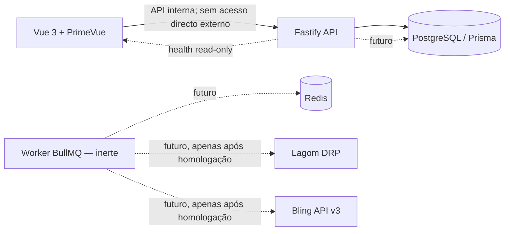

# Arquitectura do middleware

## Componentes



## Decisões

A base usa monorepo pnpm com `apps/api`, `apps/web`, `apps/worker` e pacotes `domain`/`connectors`. API HTTP e worker são processos separados. Os conectores actuais publicam interfaces e um registo de contratos; não fazem chamadas externas. A transferência nativa de estoque no Bling está bloqueada por falta de endpoint confirmado.

O schema Prisma é único em `prisma/schema.prisma`, e as migrações ficam em `prisma/migrations/`. PostgreSQL guarda configuração, execuções, transacções, tentativas, vínculos, checkpoints, reconciliações, eventos, dead letters, tokens cifrados e auditoria. Redis/BullMQ ficam como dependências preparadas; não há queue/scheduler registado nesta fase.

A interface Vue consulta apenas `/api/health`. As telas sem persistência exibem estado vazio ou decisões documentais; não geram métricas fictícias. OAuth Bling e teste de leitura são implementados na API com chave administrativa, state de uso único, cookie de sessão, tokens cifrados e renovação serializada no PostgreSQL. Consulte [operação OAuth](bling-oauth.md). Rotas de auditoria, reprocessamento e configuração geral permanecem ausentes.

## Fluxos futuros

```mermaid
sequenceDiagram
    participant S as Scheduler (desligado)
    participant W as Worker
    participant DB as PostgreSQL
    participant L as Lagom
    participant B as Bling
    S->>W: Outbound */10 (apenas após autorização)
    W->>L: Ler elegíveis (contrato confirmado; sandbox não testada)
    W->>DB: Persistir intenção e chave idempotente
    W->>B: Criar pedido (somente após homologação)
    W->>B: Consultar confirmação/ID de destino
    W->>DB: Confirmar e avançar checkpoint após evidência
    Note over W,B: Transferência de estoque permanece BLOQUEADA
```

## Dependências entre módulos

`domain` contém estados e idempotência. `connectors` contém portas/contratos e guardas. API e worker dependem dessas camadas, não de DTOs externos dentro das regras de domínio. Frontend chama exclusivamente a API interna. Nenhum pacote partilha segredos com o browser.